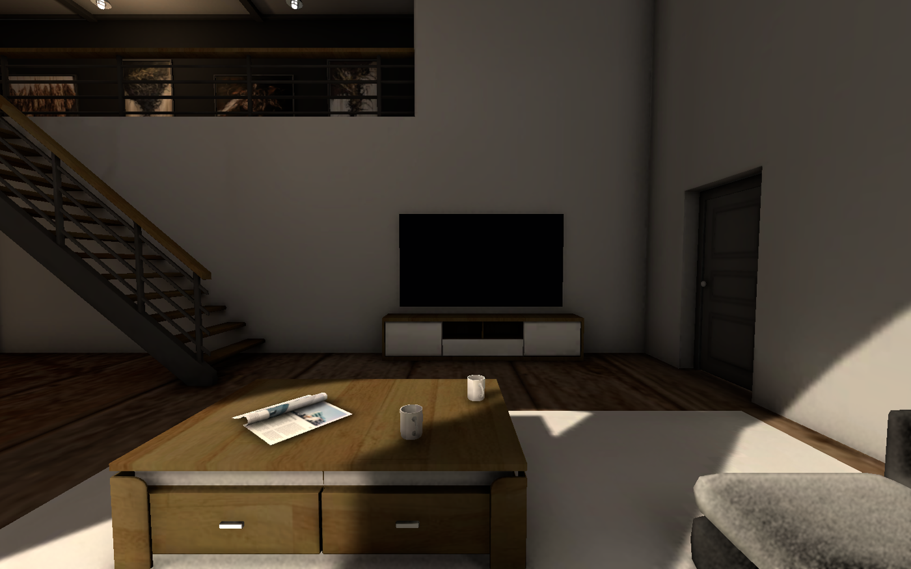
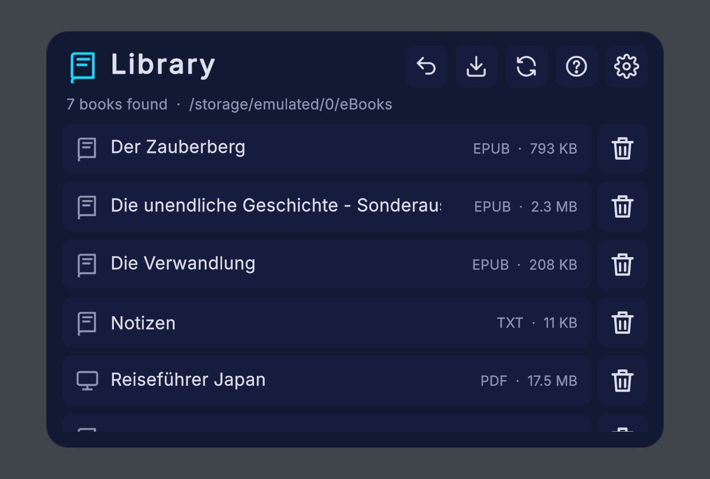
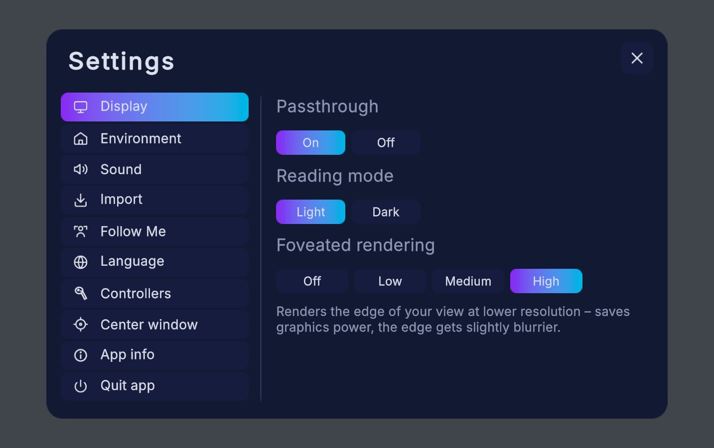

# PFD eReader

**An immersive eBook and comic reader for the Play For Dream MR headset (PFDMR).**

*[Deutsche Version](README.de.md)*

Read your books as a real 3D book that you hold in front of you – in passthrough, in the dark, or in one of three cosy 3D rooms. Turn pages with the controller, sit down on the sofa, put on some music or watch YouTube on the TV in the room.

> **Beta** – current version: **v0.2.0**. Feedback and bug reports are welcome via [Issues](https://github.com/urscaviezel/PFD-eReader/issues).

## Features

- **Formats:** EPUB, FB2 / FB2.ZIP, PDF, TXT, HTML, Markdown – comics as CBZ/ZIP, CBR (RAR), CB7 (7-Zip) and CBT (TAR)
- **3D book** with real page turning, bookmarks, chapter list, adjustable font size, light/dark reading mode, PDF zoom
- **Environments:** passthrough, dark, 3D rooms (Loft, Spa Suite, Resort Suite) with day/night, your own 360° panoramas
- **Move around** the rooms (walk, turn, teleport), sit down on sofas and chairs
- **TV** with YouTube (TV interface, sign-in via code), spatial sound
- **Sound:** ambient sounds and your own music (MP3, M4A, OGG, FLAC, WAV …)
- **Import** from your PC/NAS (SMB network shares) or from the headset's folders
- **Languages:** English, German, French
- **Performance:** foveated rendering, uses the refresh rate set on the headset (72/80 Hz recommended)
- **Updates:** the app checks GitHub for new versions and installs them after your confirmation

| Library | Settings |
|---|---|
|  |  |

## Installation

1. Download `PFD-eReader-vX.Y.Z.apk` from the [latest release](https://github.com/urscaviezel/PFD-eReader/releases/latest).
2. Install it on the headset, e.g. with `adb install PFD-eReader-vX.Y.Z.apk` (developer mode) or with a sideloading tool.
3. Start **PFD eReader** and allow access to the **eBooks** folder when asked.
4. Copy your books into the folder **eBooks** on the headset (or use *Settings → Import*).

The illustrated guide (EN/DE/FR) is built into the app (**?** button in the library) and attached to every release.

### Updating

*Settings → App info → Check for updates* (or automatically once a day). Android asks you to allow "Install unknown apps" for PFD eReader the first time.

> **Note for beta testers of earlier versions:** from v0.2.0 on the app is signed with a new release key. Please uninstall the old version once before installing v0.2.0. Your books in the eBooks folder stay where they are.

## Building from source

Requirements:

- **Unity 6000.6.5f1** (6.6) with Android Build Support
- **Play For Dream Unity SDK 3.1.0** (`com.yvr.*` packages) from the Play For Dream developer portal. `Packages/manifest.json` expects it at `../../_Shared/PFDMR-SDK/UnitySDK_3_1_0/` – adjust the `file:` paths if you put it elsewhere.

Optional, not included in this repository because of their licenses:

- **3D WebView for Android** by Vuplex (commercial) – enables the TV. Import it into `Assets/Vuplex/`; the define `PFD_VUPLEX` is then set automatically. Without it the app builds without the TV.
- **3D rooms** (from Fab) and **sky panoramas** (Unity Asset Store). Without them the app offers passthrough, dark and your own panoramas. The editor tools for building rooms are included (`Assets/PFDReader/Editor/RoomTools.cs`).

Open the project, switch to Android and build (`File → Build Profiles`). Release builds are signed with a key that is not part of the repository; use your own key.

## License

The source code of PFD eReader is released under the **[MIT License](LICENSE)**.
Third-party components keep their own licenses – see **[THIRD_PARTY_NOTICES.md](THIRD_PARTY_NOTICES.md)**.

PFD eReader is an independent project and is not affiliated with Play For Dream, Google/YouTube, Vuplex or Epic Games.
